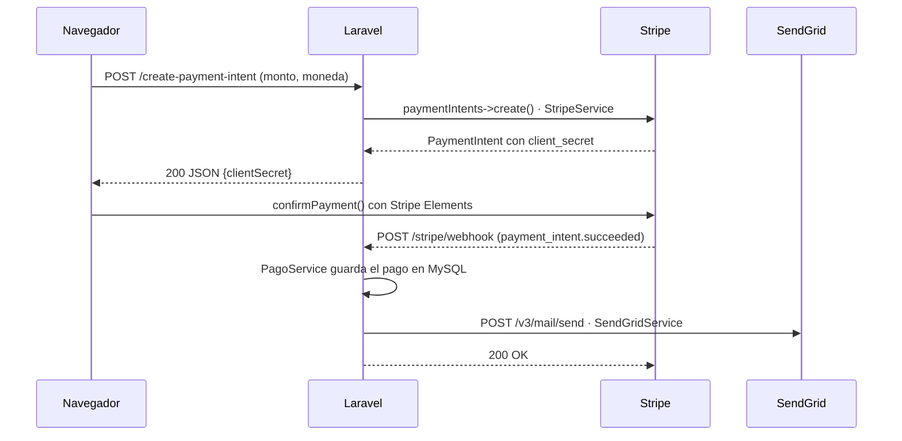

# CloudSpace Solutions · Taller Laravel: Consumo de APIs

Aplicación web en Laravel para la plataforma de reserva y alquiler de espacios de coworking y salas de conferencias de **CloudSpace Solutions**. Integra dos servicios externos mediante una **capa de servicios**:

- **Stripe** (SDK oficial `stripe/stripe-php`): checkout con **Stripe Elements**, intento de pago (**PaymentIntent**) creado en el servidor y **webhook** que registra cada pago en MySQL.
- **SendGrid** (API REST v3): correo de confirmación del pago y un módulo web para enviar correos de prueba.

Incluye además un historial de pagos y una sección de **Logs** donde quedan los eventos y los errores que devuelven las APIs.

## Creadores

| Nombre | GitHub |
| --- | --- |
| Sebastian Lizcano | [@Hypnostian](https://github.com/Hypnostian) |

## Tecnologías

- Laravel 13 · PHP 8.5
- Stripe PHP SDK 22 (API `2026-09-30.endive`) y Stripe.js v3 (Payment Element)
- SendGrid Web API v3 con el cliente HTTP de Laravel
- MySQL 8.4
- Stripe CLI 1.54 en un contenedor (reenvía los eventos al webhook)
- Docker con Laravel Sail · Blade + CSS propio (sin compilación con npm)

## Requisitos funcionales

### Módulo 1: Procesamiento de Pagos (Stripe API)

- **RF 1.1 · `GET /checkout`:** formulario con el **monto** y la **moneda** (COP, USD, EUR o MXN), más el nombre del titular, el correo para la confirmación y un concepto opcional. Las tarjetas de espacios del inicio abren el checkout con el concepto, el monto y la moneda ya diligenciados.
- **RF 1.2 · `POST /create-payment-intent`:** `CheckoutController@store` valida la petición (`CrearPaymentIntentRequest`) y delega el cobro a `App\Services\StripeService`, que vuelve a validar las reglas del negocio (moneda habilitada, mínimo de Stripe por moneda, máximo de 999.999,99 y dos decimales), convierte el monto a la unidad mínima (`120000` COP → `12000000`) y crea el PaymentIntent con el SDK. Responde en JSON:

  ```json
  {"clientSecret": "pi_..._secret_...", "paymentIntentId": "pi_...", "monto": "$ 120.000 COP"}
  ```

  | Campo | Reglas |
  | --- | --- |
  | monto | obligatorio, numérico, mayor que cero, máximo 2 decimales y dentro del rango de la moneda |
  | moneda | obligatoria: `cop`, `usd`, `eur` o `mxn` |
  | nombre | obligatorio, texto, máximo 100 caracteres |
  | email | obligatorio, correo válido, máximo 150 caracteres |
  | concepto | opcional, texto, máximo 150 caracteres |

- **RF 1.3 · Stripe Elements:** la vista recibe el `clientSecret`, inicializa `stripe.elements({ clientSecret })` y monta el **Payment Element**, que solo ofrece tarjeta porque el PaymentIntent se crea con `allowed_payment_method_types: ['card']`. `stripe.confirmPayment()` completa el cobro directamente con Stripe (incluido 3D Secure) y luego se muestra `/checkout/resultado` con el estado en Stripe y si el webhook ya registró el pago. Los datos de la tarjeta nunca pasan por el servidor de la aplicación.

### Módulo 2: Recepción de Notificaciones Asíncronas (Stripe Webhook)

- **RF 2.1 · `POST /stripe/webhook`:** `StripeService::construirEvento()` verifica la cabecera `Stripe-Signature` con `STRIPE_WEBHOOK_SECRET` (`Webhook::constructEvent`) y `PagoService` procesa el evento:
  - `payment_intent.succeeded` → guarda el pago como **exitoso** en la tabla `pagos` (un registro por PaymentIntent, aunque Stripe repita el evento) y dispara el evento `PagoConfirmado`.
  - `payment_intent.payment_failed` → guarda el rechazo con su motivo (sin reemplazar un pago que ya estaba exitoso).
  - Responde **200 OK** `{"received": true, ...}`; **400** si la firma no es válida, falta o el cuerpo no es JSON; **500** si falta el secreto o no se pudo guardar el pago (Stripe reintenta).
  - Solo registra los pagos creados por este checkout (metadata `origen = cloudspace`): la cuenta de prueba de Stripe es compartida en clase y `stripe listen` recibe también los pagos de otras aplicaciones, que quedan como "Evento ignorado" en los logs.

### Módulo 3: Envío de Correos Transaccionales (SendGrid Mail)

- **RF 3.1 · Servicio de correo:** `App\Services\SendGridService` consume `POST https://api.sendgrid.com/v3/mail/send` con `Http::withToken(SENDGRID_API_KEY)`. Envía una *personalization* por destinatario (nadie ve los correos de los demás), versión en texto plano y HTML, y traduce los errores de SendGrid (401 API key inválida, 403 remitente sin verificar, 429 límite, 5xx caída). Tras la confirmación del pago, el listener `EnviarConfirmacionDePago` usa este servicio: el módulo de pagos no conoce a SendGrid, solo dispara el evento.
- **RF 3.2 · `GET /email` y `POST /email`:** formulario con datos de prueba (asunto y mensaje precargados) para enviar a uno o varios destinatarios (máximo 10, separados por comas o saltos de línea). `EmailController` valida con `EnviarCorreoRequest`, llama al servicio y vuelve a la vista con el resultado o con el motivo del error.

### Extras

- **`GET /pagos`:** historial de los pagos registrados por el webhook (estado, tarjeta, motivo del rechazo, si se envió el correo) con el recaudo por moneda.
- **`GET /logs`:** sección de logs con los eventos y errores de Stripe, el webhook y SendGrid (ver [Logs](#logs)).
- `POST /create-payment-intent` y `POST /email` tienen límite de peticiones por minuto (`throttle`), porque llaman a APIs externas.
- Mensajes de validación en español, páginas 404, 419 y 429 propias y diseño adaptable a celulares.

## Requisitos no funcionales

| Requisito | Implementación |
| --- | --- |
| RNF 1 · Service Layer | Toda la comunicación externa está en `app/Services`: `StripeService` (SDK de Stripe), `SendGridService` (API REST) y `PagoService` (registro de pagos). Los controladores solo validan, delegan y responden; los modelos no llaman APIs. Una prueba automatizada revisa que ningún controlador ni modelo use el SDK de Stripe ni el cliente HTTP. |
| RNF 2 · Variables de entorno | `STRIPE_KEY`, `STRIPE_SECRET`, `STRIPE_WEBHOOK_SECRET`, `SENDGRID_API_KEY` y `SENDGRID_FROM_ADDRESS` están solo en `.env` y se mapean en `config/services.php` (`services.stripe.*` y `services.sendgrid.*`). Al navegador solo llega la llave publicable. |
| RNF 2 · CSRF | `bootstrap/app.php`: `$middleware->preventRequestForgery(except: ['stripe/webhook'])`. En Laravel 13 el middleware CSRF se llama `PreventRequestForgery` y `validateCsrfTokens()` quedó como alias obsoleto. Los formularios y el `fetch` del checkout sí envían el token (`@csrf` y `X-CSRF-TOKEN`). |
| RNF 3 · Respuestas | Las operaciones asíncronas responden JSON: `/create-payment-intent` con 200, 400 (datos inválidos o rechazados por Stripe) y 500 (Stripe no configurado o caído); `/stripe/webhook` con 200, 400 y 500. Las interacciones web (`/checkout`, `/checkout/resultado`, `/email`, `/pagos`, `/logs`) devuelven vistas Blade. |

## Arquitectura



| Clase | Responsabilidad |
| --- | --- |
| `App\Services\StripeService` | Validar el cobro, crear y consultar PaymentIntents, describir la tarjeta y verificar la firma del webhook |
| `App\Services\PagoService` | Registrar en MySQL los pagos exitosos y rechazados que notifica el webhook |
| `App\Services\SendGridService` | Enviar correos con la API REST v3 y traducir sus errores |
| `App\Events\PagoConfirmado` + `App\Listeners\EnviarConfirmacionDePago` | Enviar el correo de confirmación de forma desacoplada |
| `App\Logging\GuardarEnBaseDeDatos` | Handler de Monolog que guarda los logs del canal `integraciones` en la tabla `registros` |
| `App\Exceptions\*` | `PagoInvalidoException` (400), `ServicioExternoException` (500) y `WebhookInvalidoException` (400) |

## Modelo de datos

Tabla `pagos` (`database/migrations/2026_10_20_143351_create_pagos_table.php`):

| Columna | Tipo | Detalle |
| --- | --- | --- |
| id | bigint autoincremental | clave primaria |
| payment_intent_id | varchar(255) | único: un registro por PaymentIntent |
| estado | enum('exitoso', 'fallido') | con índice |
| monto | decimal(12, 2) | en la unidad principal de la moneda |
| moneda | char(3) | `cop`, `usd`, `eur` o `mxn` |
| cliente_nombre / cliente_email | varchar(100) / varchar(150) | tomados de la metadata del PaymentIntent |
| concepto | varchar(150) | opcional |
| tarjeta | varchar(60) | p. ej. `Visa •••• 4242` |
| error | varchar(255) | motivo del rechazo |
| stripe_event_id | varchar(255) | último evento procesado |
| pagado_at / correo_enviado_at | timestamp | fecha del pago y del correo de confirmación |
| created_at / updated_at | timestamp | |

Tabla `registros` (`database/migrations/2026_10_20_150209_create_registros_table.php`): `nivel` (info, warning, error), `servicio` (stripe, webhook, sendgrid), `mensaje`, `contexto` (JSON con los datos del evento o del error) y `created_at`.

## Rutas

| Método | URI | Respuesta |
| --- | --- | --- |
| GET | `/` | vista: inicio con los espacios |
| GET | `/checkout` | vista: formulario de checkout (RF 1.1) |
| POST | `/create-payment-intent` | JSON: 200 · 400 · 419 · 429 · 500 (RF 1.2) |
| GET | `/checkout/resultado?payment_intent=pi_...` | vista: resultado del pago · 404 si la referencia no es válida |
| POST | `/stripe/webhook` | JSON: 200 · 400 · 500 (RF 2.1, sin CSRF) |
| GET | `/pagos` | vista: historial de pagos |
| GET | `/email` | vista: formulario de envío (RF 3.2) |
| POST | `/email` | redirección a `/email` con el resultado o los errores |
| GET | `/logs?filtro=problemas\|stripe\|webhook\|sendgrid` | vista: logs de integraciones |

## Variables de entorno

| Variable | Uso |
| --- | --- |
| `STRIPE_KEY` | Llave publicable `pk_test_...` (la usa Stripe.js en el navegador) |
| `STRIPE_SECRET` | Llave secreta `sk_test_...` (la usan `StripeService` y el contenedor `stripe-cli`) |
| `STRIPE_WEBHOOK_SECRET` | Secreto de firma `whsec_...` que muestra `./vendor/bin/sail logs stripe-cli` |
| `SENDGRID_API_KEY` | API key de SendGrid con permiso *Mail Send* |
| `SENDGRID_FROM_ADDRESS` / `SENDGRID_FROM_NAME` | Remitente verificado en SendGrid (Sender Identity) y su nombre |
| `SENDGRID_SANDBOX` | `true`: SendGrid valida la petición, pero no entrega el correo |
| `APP_PORT` / `FORWARD_DB_PORT` / `VITE_PORT` | Puertos publicados: 8082, 3309 y 5176 |

Las llaves de Stripe son las de **modo de prueba** (dashboard.stripe.com → Developers → API keys). Ninguna credencial está escrita en el código ni en `.env.example`.

## Ejecución con Docker (Laravel Sail)

Requiere Docker Desktop. Los comandos se ejecutan desde **Ubuntu (WSL)** dentro de `ConsumoAPIs/cloudspace`. Los contenedores son `cloudspace-laravel.test-1`, `cloudspace-mysql-1` y `cloudspace-stripe-cli-1`.

| Servicio | Dirección |
| --- | --- |
| Aplicación | http://localhost:8082 |
| MySQL | `localhost:3309` · base `cloudspace` · usuario `sail` · contraseña `password` |
| Webhook (dentro de Docker) | `stripe-cli` reenvía a `http://laravel.test/stripe/webhook` |

Los puertos son distintos a los de los otros talleres, así que pueden estar encendidos al mismo tiempo.

### Primera vez (después de clonar el repositorio)

```bash
cp .env.example .env
docker run --rm -u "$(id -u):$(id -g)" -v "$(pwd):/var/www/html" -w /var/www/html laravelsail/php84-composer:latest composer install --ignore-platform-reqs
# Completar en .env: STRIPE_KEY, STRIPE_SECRET, SENDGRID_API_KEY y SENDGRID_FROM_ADDRESS
./vendor/bin/sail up -d
./vendor/bin/sail artisan key:generate
./vendor/bin/sail artisan migrate
./vendor/bin/sail logs stripe-cli   # copiar el whsec_... en STRIPE_WEBHOOK_SECRET del .env
```

El secreto que muestra `stripe-cli` es el mismo cada vez que se enciende con la misma llave, así que solo se configura una vez. Si se cambia `STRIPE_SECRET`, `./vendor/bin/sail up -d` vuelve a crear el contenedor con la llave nueva.

### Uso diario

```bash
./vendor/bin/sail up -d                 # encender (app, MySQL y stripe-cli)
./vendor/bin/sail logs -f stripe-cli    # ver los eventos que Stripe reenvía al webhook
./vendor/bin/sail artisan test          # pruebas automatizadas
./vendor/bin/sail stop                  # apagar
```

Desde PowerShell, en la misma carpeta:

```powershell
docker compose up -d
docker compose logs -f stripe-cli
docker compose stop
```

### Paso a paso con el que se construyó

| Paso | Comando |
| --- | --- |
| Proyecto Laravel 13 | `composer create-project laravel/laravel cloudspace` (imagen `laravelsail/php84-composer`) |
| Sail con MySQL | `composer require laravel/sail --dev` y `php artisan sail:install --with=mysql` |
| SDK oficial de Stripe | `composer require stripe/stripe-php` |
| Modelo, migración y factory de pagos | `./vendor/bin/sail artisan make:model Pago -m -f` |
| Controladores | `./vendor/bin/sail artisan make:controller CheckoutController` (y `StripeWebhookController --invokable`, `EmailController`, `PagoController`, `LogController`, `InicioController --invokable`) |
| Validación | `./vendor/bin/sail artisan make:request CrearPaymentIntentRequest` y `EnviarCorreoRequest` |
| Evento y listener del correo | `./vendor/bin/sail artisan make:event PagoConfirmado` y `make:listener EnviarConfirmacionDePago --event=PagoConfirmado` |
| Logs | `./vendor/bin/sail artisan make:model Registro -m` |
| Migrar | `./vendor/bin/sail artisan migrate` |

## Pruebas manuales

### Tarjetas de prueba de Stripe

| Tarjeta | Resultado |
| --- | --- |
| `4242 4242 4242 4242` | Pago aprobado |
| `4000 0025 0000 3155` | Pide autenticación 3D Secure |
| `4000 0000 0000 9995` | Rechazada por fondos insuficientes |

Con cualquier fecha futura y cualquier CVC de 3 dígitos. Flujo: `/checkout` → **Continuar al pago** (crea el PaymentIntent) → datos de la tarjeta → **Pagar** → `/checkout/resultado`, `/pagos` y `/logs`.

### Webhook sin pasar por el navegador

```bash
./vendor/bin/sail exec stripe-cli stripe trigger payment_intent.succeeded \
  --add "payment_intent:metadata[origen]=cloudspace" \
  --add "payment_intent:metadata[cliente_nombre]=Juan Sebastian Lizcano Jaimes" \
  --add "payment_intent:metadata[cliente_email]=jlizcano471@unab.edu.co"
```

Sin `metadata[origen]=cloudspace` el evento llega igual, pero se ignora porque el pago no se creó en este checkout.

### Pruebas realizadas (20/10/2026, a nombre de Juan Sebastian Lizcano Jaimes)

| # | Prueba | Resultado |
| --- | --- | --- |
| 1 | Checkout de *Sala de conferencias (2 horas)* por $ 120.000 COP con la tarjeta 4242 | Stripe: **Pagado** (Visa •••• 4242, `pi_3USjRiQfSk9EHZDs0gVxpdip`). El webhook recibió `payment_intent.succeeded`, respondió **200** y registró el pago en MySQL. |
| 2 | *Puesto flexible (1 día)* por $ 45.000 COP: PaymentIntent creado desde el checkout y confirmado con la tarjeta de prueba de fondos insuficientes (`stripe payment_intents confirm <pi> --payment-method=pm_card_chargeDeclinedInsufficientFunds`) | Stripe: `card_declined` / `insufficient_funds`. El webhook recibió `payment_intent.payment_failed`, respondió **200** y registró el pago como **fallido** con el motivo. |
| 3 | `stripe trigger payment_intent.succeeded` con la metadata del checkout | Pago de US$ 20,00 registrado como exitoso. |
| 4 | Correo de confirmación (pruebas 1 y 3) y envío desde `/email` a jlizcano471@unab.edu.co | SendGrid respondió **401** (*The provided authorization grant is invalid, expired, or revoked*) con la API key de la clase. El pago quedó registrado igual y el error aparece en `/logs` con el destinatario, el remitente y el detalle. Con una API key válida y un remitente verificado el mismo flujo envía el correo. |

## Logs

La sección **Logs** (`/logs`) muestra todo lo que pasa con las integraciones, con filtros por servicio y por problemas (errores y advertencias):

| Servicio | Qué se registra |
| --- | --- |
| Stripe | PaymentIntent creado, cobro rechazado por Stripe, llave secreta inválida o faltante, errores de la API |
| Webhook | Pago registrado, pago rechazado por el banco, firma inválida, evento ignorado, error al guardar el pago |
| SendGrid | Correo enviado (con su `X-Message-Id`) o el error de la API (código HTTP, detalle, remitente y destinatarios) |

Se escriben con el canal de log `integraciones` (`config/logging.php`), que guarda cada registro en dos lugares:

- La tabla `registros`, que se consulta en `/logs` (handler `App\Logging\GuardarEnBaseDeDatos`).
- El archivo diario `storage/logs/integraciones-AAAA-MM-DD.log`.

Si SendGrid falla, el pago no se pierde: el webhook responde 200, el pago queda registrado y en `/pagos` el correo aparece como "No enviado", con enlace a los logs.

## Pruebas automatizadas

```bash
./vendor/bin/sail artisan test
```

99 pruebas sobre la base `testing` de MySQL que no llaman a Stripe ni a SendGrid de verdad: el SDK de Stripe usa un cliente HTTP falso (`tests/Support/StripeHttpFalso.php`) que revisa los parámetros enviados, y SendGrid se simula con `Http::fake()`. Los datos de prueba están a nombre de Juan Sebastian Lizcano Jaimes. Cubren:

- La conversión de montos y monedas, los mínimos y máximos, los rechazos de Stripe (400) y sus fallas (500).
- El checkout con Stripe Elements y la página de resultado.
- El webhook: firma válida, alterada, vencida o ausente; pagos repetidos, rechazados y de otras aplicaciones; y el reintento del correo.
- El JSON de SendGrid, la traducción de sus errores y el modo sandbox.
- El formulario de correos con varios destinatarios.
- La exención CSRF del webhook, la ausencia de credenciales en el código, la capa de servicios y la sección de logs.
